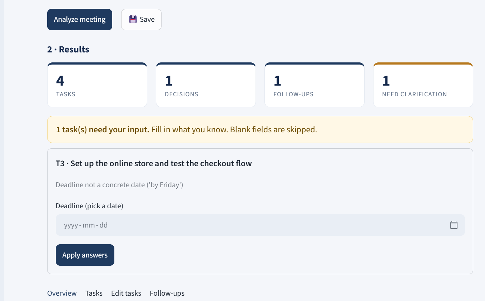

# Meeting-to-Action Assistant

Turns meeting transcripts into a summary, decisions, tasks (owner, deadline, priority) and follow-ups.
Detects incomplete or ambiguous action items and asks the user for clarification.

Uses the Google Gemini API free tier (get a key at aistudio.google.com/apikey). Change `MODEL_NAME` to use another model.

## How it works
1. **Extract**: an LLM call returns strict JSON (never guesses missing owners/deadlines; uses null).
2. **Validate**: rule-based checks flag missing/generic owners, missing or non-concrete deadlines, and vague wording.
3. **Clarify**: the app asks targeted questions and updates the tasks.
4. **Export**: download tasks as CSV.

## Run locally
```
pip install -r requirements.txt
export GEMINI_API_KEY="your-key"         # Windows: set GEMINI_API_KEY=your-key
streamlit run app.py                     # web UI
python cli.py sample_transcript.txt 2026-10-20   # command line
```

## Deploy (Streamlit Community Cloud)
Push to GitHub, create the app at share.streamlit.io, and add this under Advanced settings → Secrets:
```
GEMINI_API_KEY = "your-key"
```

## Project structure
- `core.py`: extraction, validation, clarification, CSV export
- `app.py`: Streamlit UI (login, saved meetings, calendar date pickers, task editor)
- `ui.py`: theme CSS and card helpers
- `db.py`: accounts + saved meetings (SQLite locally, Postgres via `DATABASE_URL`)
- `.streamlit/config.toml`: theme colors
- `cli.py`: command-line version
- `sample_transcript.txt`: demo input

## Saving data
Locally, data is stored in `meetings.db` (SQLite). For deployment, set `DATABASE_URL` to a free Postgres (Supabase or Neon) in Streamlit secrets, because Streamlit Cloud's disk is not permanent.

## Evaluation
```
python eval.py
```
Runs the app's extraction on `tests/cases.json` (10 labeled meetings) and reports task recall/precision, owner and deadline accuracy, and how well unclear items are flagged. Add your own cases to the JSON file.

## Evaluation results

Tested on 10 labeled test meetings (24 tasks) in `tests/cases.json` using `gemini-3.5-flash-lite`.

| Metric | Result |
|---|---|
| Task recall (real tasks found) | 96% |
| Task precision (found tasks that were real) | 100% |
| Owner accuracy | 100% |
| Deadline accuracy | 100% |
| Flagging recall (unclear items caught) | 100% |
| Flagging precision (flags that were correct) | 100% |

**Notes**
- The test meetings were written for this project, not recorded from real meetings.
- One ambiguous test sentence was corrected after the first run, and the evaluation was rerun.
- Known weakness: the model can miss scheduling tasks when the date refers to the event itself (for example, "book the call for next Monday").
- Results can vary slightly between runs because the model is not fully deterministic.

Reproduce with `python eval.py` (needs a Gemini API key).

# Meeting-to-Action Assistant

   **Live demo:** https://meeting-to-action.streamlit.app

   Turns meeting transcripts into summaries, decisions and owner/deadline-tagged tasks, and asks for clarification when something is vague or missing.

   > The demo uses a free Gemini quota, so it may stop working when the daily limit is reached. Please don't enter confidential meeting content.

   

## License
   MIT. See the LICENSE file.